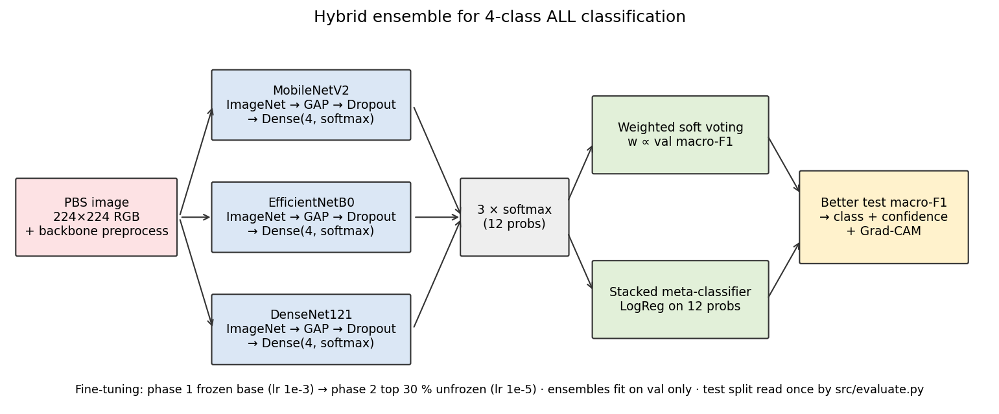
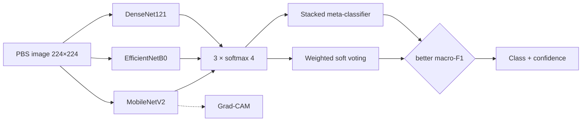

# Blood Cancer Identification using Hybrid Ensemble Deep Learning

Three transfer-learning CNNs (MobileNetV2, EfficientNetB0, DenseNet121) are combined by a **hybrid ensemble** (weighted soft voting + a stacked logistic-regression meta-classifier) to classify peripheral blood smear images into four Acute Lymphoblastic Leukemia (ALL) classes. The whole pipeline runs from a web dashboard.

> ⚠️ **Research / educational project. Not a medical device. Not for clinical use.**

## Setup

Three tiers. **Tier 1 is all you need to see the system work** — tiers 2 and 3 are optional.

### Tier 1 — Demo in 5 minutes (default, no Kaggle account)

```bash
git clone https://github.com/vvvvvivekkk/blood-cancer-detection.git
cd blood-cancer-detection
pip install -r requirements.txt
python run.py --fetch-models          # trained models from the pinned release (~105 MB)
python app.py                         # opens http://localhost:8000
```

Log in with **admin / admin**. The Preview page is pre-loaded with the 40 bundled
demo images, so you can predict, see Grad-CAM, and read the metrics immediately.
Nothing else to download.

### Tier 2 — Full test set (optional, ~6 GB)

Only needed to run predictions across all 487 held-out test images.

1. Get a Kaggle API token (Kaggle → Account → *Create New API Token*).
2. Paste it on the **Data** page, or drop `kaggle.json` in `~/.kaggle/`.
3. Press **Download** on the Data page, then:

```bash
python run.py --cli export-test-images   # 10 per class into test_images/
```

### Tier 3 — Retrain from scratch (optional)

Needs Tier 2 first.

```bash
# Option A — free Colab GPU, ~40 min
#   open notebooks/train_colab.ipynb, run all, copy models/ back into the repo

# Option B — local CPU, ~1.5 h
python run.py --cli all

python run.py --cli evaluate             # refresh results/ + figures
```

## What is where

| Path | What it holds |
|---|---|
| `models/` | 3 `.keras` backbones + ensemble weights, meta-classifier, mode, OOD stats. Not in git — fetched from the release. |
| `data/demo_images/` | 40 real test-split images (10 per class). Committed. Drives the Tier 1 demo. CC BY 4.0, Aria et al. |
| `data/sample/` | 8 tiny synthetic images. Committed. Used by the automated tests only — not a demo. |
| `data/raw/`, `data/splits/` | The Kaggle dataset and generated splits. Gitignored, created by Tier 2. |
| `results/` | `metrics.json` (source of truth), comparison table, `figures/`, training history. |
| `docs/` | Client deliverables: `HOW_IT_WORKS.pdf`, `project_report.pdf`, `ieee_paper.pdf`, `DOCUMENTATION.pdf`. |
| `docs/src/` | The HTML/Markdown sources those PDFs are generated from. |
| `scripts/` | Packaging, export, doc-build and screenshot tooling. |

The 40 demo images come from the held-out test split and were **never used in training or
validation**. Source: [Blood Cells Cancer (ALL)](https://www.kaggle.com/datasets/mohammadamireshraghi/blood-cell-cancer-all-4class)
by M. Aria et al., licensed [CC BY 4.0](https://creativecommons.org/licenses/by/4.0/).

## Results

<!-- RESULTS:START -->
| Model | Accuracy | Macro-F1 | Weighted-F1 | Kappa | ROC-AUC (OvR) |
|---|---|---|---|---|---|
| MobileNetV2 | 96.92% | 0.9662 | 0.9695 | 0.9583 | 0.9981 |
| EfficientNetB0 | 91.38% | 0.9114 | 0.9126 | 0.8828 | 0.9973 |
| DenseNet121 | 98.97% | 0.9890 | 0.9898 | 0.9861 | 0.9994 |
| Ensemble-Voting | 98.36% | 0.9809 | 0.9837 | 0.9777 | 0.9995 |
| **Ensemble-Stacking** (selected) | **98.97%** | **0.9883** | **0.9898** | **0.9861** | **0.9997** |

_487 test images, Kaggle data, 2026-10-09. Regenerate with `python -m src.evaluate --write-readme-table`._
<!-- RESULTS:END -->

## Architecture





## Project structure

```
run.py      single entry point: UI, or --cli stages
src/        config · status · download · data · models · train · ensemble · predict · evaluate · gradcam · pipeline
api/        main.py (FastAPI routes), jobs.py (background job runner)
frontend/   index.html, css/styles.css, js/{app,api,charts}.js
models/     <backbone>.keras, ensemble_weights.json, meta_clf.pkl, ensemble_mode.txt
results/    metrics.json, comparison_table.md, NOTES.md, split_counts.csv, history/, figures/
notebooks/  train_colab.ipynb
docs/       HOW_IT_WORKS.pdf (client guide), project_report.pdf, screenshots/
tests/      pytest suite (no network, no GPU)
```

## Key commands

```bash
python run.py                                # web app at http://localhost:8000
python run.py --cli all --smoke              # full pipeline on CPU (~2 min)
python run.py --cli export-test-images       # 10 test images per class for demo
python run.py --fetch-models                 # download + verify models from the release
python run.py --check                        # verify model SHA-256 checksums
python -m pytest -q                          # run test suite
```

## Documentation

| Document | Audience | Description |
|---|---|---|
| [`docs/HOW_IT_WORKS.pdf`](docs/HOW_IT_WORKS.pdf) | Client | 29-page plain-English explanation with figures, installation, and walkthrough |
| [`docs/HOW_IT_WORKS.docx`](docs/HOW_IT_WORKS.docx) | Client | Same content, editable Word format |
| [`docs/project_report.pdf`](docs/project_report.pdf) | Examiner | Academic project report |
| [`docs/ieee_paper.pdf`](docs/ieee_paper.pdf) | Academic | IEEE-formatted paper |
| [`docs/DOCUMENTATION.pdf`](docs/DOCUMENTATION.pdf) | Developer | Technical reference documentation |
| `CLAUDE.md` | Developer | Engineering rules and conventions |

## Limitations

- One public dataset of pre-cropped single cells; no segmentation or external validation.
- The ensemble ties the best single backbone (DenseNet121) rather than beating it.
- Not clinically validated. Do not use for diagnosis.

## References

- M. Aria et al., "Acute Lymphoblastic Leukemia (ALL) image dataset," Kaggle, 2021. [Dataset](https://www.kaggle.com/datasets/mohammadamireshraghi/blood-cell-cancer-all-4class)
- R. R. Selvaraju et al., "Grad-CAM: Visual Explanations from Deep Networks," ICCV 2017.

## Licence

MIT, see `LICENSE`. The dataset licence is set on its Kaggle page.
