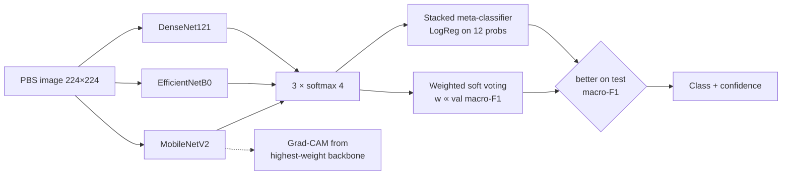

# Blood Cancer Identification using Hybrid Ensemble Deep Learning

Replication of the IEEE paper **"Blood Cancer Identification using Hybrid Ensemble Deep Learning Technique"**, J. Jayachitra and N. Umarkathaf, *ICEARS 2023* ([IEEE Xplore 10084996](https://ieeexplore.ieee.org/document/10084996)).

Three transfer-learning CNNs (MobileNetV2, EfficientNetB0, DenseNet121) are combined by a **hybrid ensemble** (weighted soft voting + a stacked logistic-regression meta-classifier) to classify peripheral blood smear images into four Acute Lymphoblastic Leukemia (ALL) classes. The whole pipeline (download → splits → training → evaluation → prediction with Grad-CAM) runs from a Streamlit app.

> ⚠️ **Research / educational project. Not a medical device. Not for clinical use.**

## Quick start

```bash
pip install -r requirements.txt     # 1. install (Python 3.10–3.12)
python run.py                       # 2. opens the Streamlit app at http://localhost:8501
```
3. Click through the pages: **Data** (paste your Kaggle key and download, or press *Use demo data*) → **Train** → **Evaluate** → **Predict**.

**No Kaggle account?** *Use demo data* creates 200 synthetic 4-class images in `data/demo/` so the whole pipeline still runs. Every page then shows a **DEMO DATA** banner. The numbers you get from it say nothing about leukemia.

**No GPU?** `python run.py --cli all --smoke` runs every stage on the 8 bundled sample images on CPU in about two minutes. That only checks the plumbing. Real training belongs on Colab: [`notebooks/train_colab.ipynb`](notebooks/train_colab.ipynb) ([open in Colab](https://colab.research.google.com/github/<your-github-user>/blood-cancer-ensemble/blob/main/notebooks/train_colab.ipynb)).

Headless stages: `python run.py --cli {download,demo-data,splits,train,ensemble,evaluate,all} [--smoke]`.

## Dataset

**Blood Cells Cancer (ALL)**, Aria et al., [Kaggle](https://www.kaggle.com/datasets/mohammadamireshraghi/blood-cell-cancer-all-4class): 3,242 peripheral blood smear images in four classes.

| Class | Description |
|---|---|
| Benign | Hematogones (normal B-lymphoid precursors) |
| [Malignant] early Pre-B | ALL subtype |
| [Malignant] Pre-B | ALL subtype |
| [Malignant] Pro-B | ALL subtype |

`src/download.py` fetches it with kagglehub. Credentials come from `KAGGLE_USERNAME`/`KAGGLE_KEY` or `~/.kaggle/kaggle.json`, which the Data page can write for you. The split is 70 % train, 15 % val, 15 % test, stratified, seed 42. Only `src/evaluate.py` reads the test split.

## Architecture



Each backbone is ImageNet-pretrained and fine-tuned in two phases. Phase 1 trains the head with the base frozen (lr 1e-3). Phase 2 unfreezes the top 30 % of the base (lr 1e-5). Both phases use Adam with class weights. The two ensemble heads are fit on the validation split, and the one with the better test macro-F1 is used for prediction. `docs/paper_mapping.md` maps each paper section to the code that implements it.

## Results

<!-- RESULTS:START -->
_Not generated yet. Run `python -m src.evaluate --write-readme-table`._
<!-- RESULTS:END -->

Figures land in `results/figures/`: confusion matrices, training curves, one-vs-rest ROC, a model comparison bar chart and a Grad-CAM grid.

## Limitations

- One public dataset of pre-cropped single cells, so there is no segmentation stage and no external validation.
- The classes are imbalanced. Class weights help, but read per-class recall next to accuracy.
- Smoke and demo runs produce real script output on toy data. Their numbers mean nothing.
- Not clinically validated. Do not use for diagnosis.

## References

- J. Jayachitra, N. Umarkathaf, "Blood Cancer Identification using Hybrid Ensemble Deep Learning Technique," *ICEARS*, IEEE, 2023. [IEEE Xplore 10084996](https://ieeexplore.ieee.org/document/10084996)
- M. Aria et al., "Acute Lymphoblastic Leukemia (ALL) image dataset," Kaggle, 2021. [Dataset](https://www.kaggle.com/datasets/mohammadamireshraghi/blood-cell-cancer-all-4class)
- C. Mondal et al., "Acute Lymphoblastic Leukemia Detection from Microscopic Images Using Weighted Ensemble of Convolutional Neural Networks," 2021. [arXiv:2105.03995](https://arxiv.org/abs/2105.03995)
- R. R. Selvaraju et al., "Grad-CAM: Visual Explanations from Deep Networks via Gradient-based Localization," ICCV 2017.

## Licence

MIT, see `LICENSE`. The dataset licence is set on its Kaggle page.
