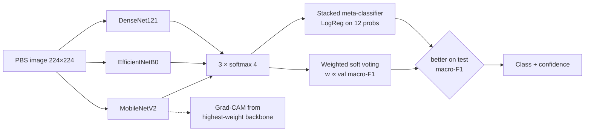
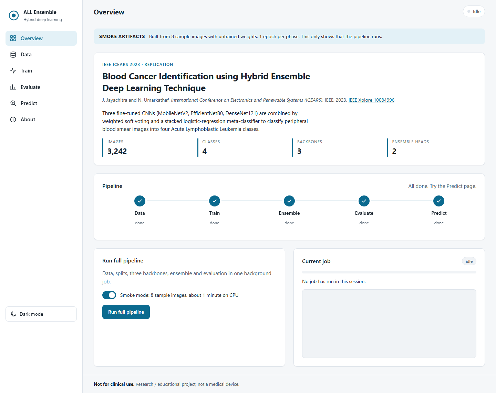
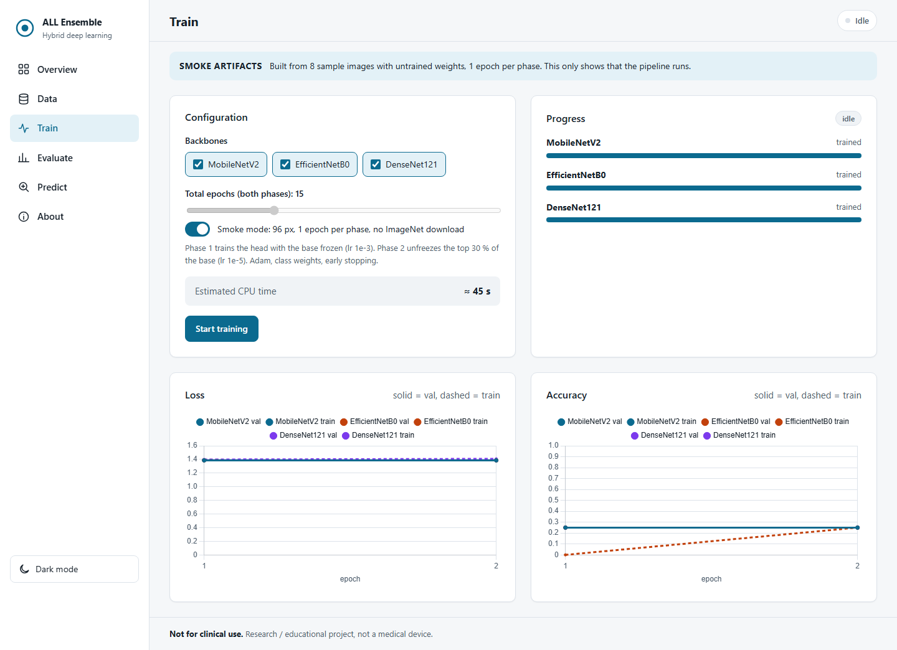
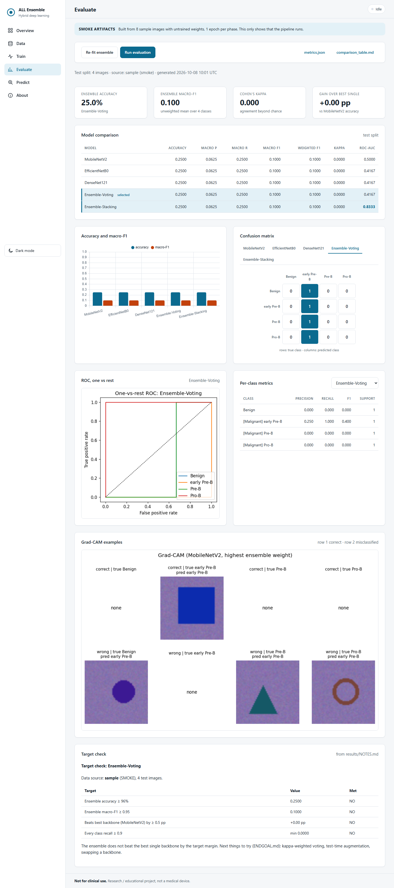
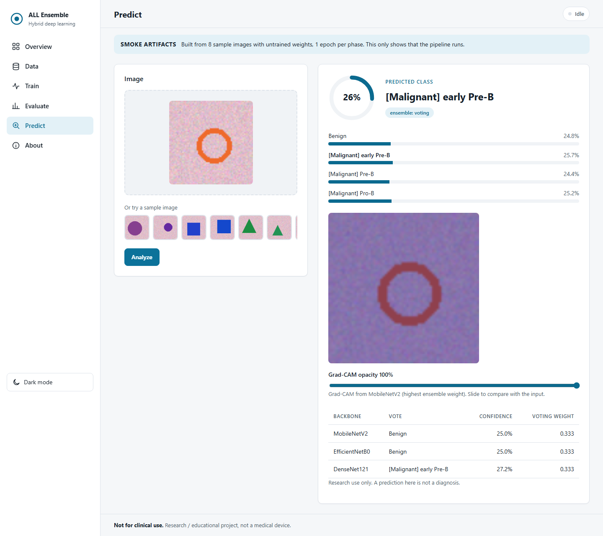

# Blood Cancer Identification using Hybrid Ensemble Deep Learning

Replication of the IEEE paper **"Blood Cancer Identification using Hybrid Ensemble Deep Learning Technique"**, J. Jayachitra and N. Umarkathaf, *ICEARS 2023* ([IEEE Xplore 10084996](https://ieeexplore.ieee.org/document/10084996)).

Three transfer-learning CNNs (MobileNetV2, EfficientNetB0, DenseNet121) are combined by a **hybrid ensemble** (weighted soft voting + a stacked logistic-regression meta-classifier) to classify peripheral blood smear images into four Acute Lymphoblastic Leukemia (ALL) classes. The whole pipeline (download → splits → training → evaluation → prediction with Grad-CAM) runs from a web dashboard (FastAPI + plain HTML/CSS/JS).

> ⚠️ **Research / educational project. Not a medical device. Not for clinical use.**

## Quick start

```bash
pip install -r requirements.txt && python run.py     # opens http://localhost:8000
```
Then work through the views in the sidebar: **Data** (paste your Kaggle key and download, or press *Use demo data*) → **Train** → **Evaluate** → **Predict**. Or press **Run full pipeline** on Overview.

`python run.py --streamlit` starts the older Streamlit UI (http://localhost:8501), which does the same things. Use `--port` and `--no-browser` to change the server's port or stop it opening a browser tab.

**No Kaggle account?** *Use demo data* creates 200 synthetic 4-class images in `data/demo/` so the whole pipeline still runs. Every page then shows a **DEMO DATA** banner. The numbers you get from it say nothing about leukemia.

**No GPU?** `python run.py --cli all --smoke` runs every stage on the 8 bundled sample images on CPU in about two minutes. That only checks the plumbing. Real training belongs on Colab: [`notebooks/train_colab.ipynb`](notebooks/train_colab.ipynb) ([open in Colab](https://colab.research.google.com/github/<your-github-user>/blood-cancer-ensemble/blob/main/notebooks/train_colab.ipynb)).

Headless stages: `python run.py --cli {download,demo-data,splits,train,ensemble,evaluate,all} [--smoke]`.

## Dataset

**Blood Cells Cancer (ALL)**, Aria et al., [Kaggle](https://www.kaggle.com/datasets/mohammadamireshraghi/blood-cell-cancer-all-4class): 3,242 peripheral blood smear images in four classes.

| Class | Description |
|---|---|
| Benign | Hematogones (normal B-lymphoid precursors) |
| [Malignant] early Pre-B | ALL subtype |
| [Malignant] Pre-B | ALL subtype |
| [Malignant] Pro-B | ALL subtype |

`src/download.py` fetches it with kagglehub. Credentials come from `KAGGLE_USERNAME`/`KAGGLE_KEY` or `~/.kaggle/kaggle.json`, which the Data page can write for you. The split is 70 % train, 15 % val, 15 % test, stratified, seed 42. Only `src/evaluate.py` reads the test split.

## Architecture




Each backbone is ImageNet-pretrained and fine-tuned in two phases. Phase 1 trains the head with the base frozen (lr 1e-3). Phase 2 unfreezes the top 30 % of the base (lr 1e-5). Both phases use Adam with class weights. The two ensemble heads are fit on the validation split, and the one with the better test macro-F1 is used for prediction. `docs/paper_mapping.md` maps each paper section to the code that implements it.

## Results

<!-- RESULTS:START -->
_Not generated yet. Run `python -m src.evaluate --write-readme-table`._
<!-- RESULTS:END -->

The table is written by `python -m src.evaluate --write-readme-table` (or `--table-only` to reuse an existing `results/metrics.json` without touching the test split again). Each run also writes `results/NOTES.md`, which states whether the ENDGOAL targets are met, and the figures in `results/figures/`: confusion matrices, training curves, one-vs-rest ROC, a model comparison bar chart and a Grad-CAM grid.

## The web app

| View | What you can do |
|---|---|
| Overview | Paper and citation, pipeline stepper (Data → Train → Ensemble → Evaluate → Predict), **Run full pipeline** with a smoke toggle, live job panel with progress and log |
| Data | Save Kaggle credentials (masked key), download, **Use demo data**, make splits, class counts per split, example images |
| Train | Choose backbones, epochs and smoke mode, see a CPU time estimate, per-backbone progress bars, live loss and accuracy curves |
| Evaluate | Fit the ensemble, run the evaluation, KPI tiles, comparison table (ensembles highlighted, selected one badged), metric chart, 5 confusion-matrix tabs, ROC, per-class metrics, Grad-CAM grid, downloads |
| Predict | Drag and drop or pick a sample image: class, confidence ring, probability bars, per-backbone votes, Grad-CAM overlay with an opacity slider |
| About | Paper summary, architecture diagram, paper → code mapping, dataset, limitations |

Every view also works with nothing trained. It says what is missing and offers the button that starts the job to fix it. Long stages run as background jobs. The UI follows them over Server-Sent Events and falls back to polling once a second. The pages support light and dark themes and keyboard navigation, and work on screens down to 768 px wide (the sidebar becomes a menu on phones).

| Overview | Train | Evaluate | Predict |
|---|---|---|---|
|  |  |  |  |

_These screenshots come from smoke artifacts (untrained weights). Re-capture them after a real run with `python docs/capture_screenshots.py` while the app is running. Dark variants are the `*_dark.png` files._

### API

| Method | Path | Purpose |
|---|---|---|
| GET | `/api/health` | Liveness, models on disk, ensemble mode |
| GET | `/api/status` | Pipeline status, stepper states, demo flag, active job id |
| POST | `/api/data/kaggle-creds` | Save `~/.kaggle/kaggle.json` (`{username, key}`) |
| POST | `/api/data/download` | Job: kagglehub download |
| POST | `/api/data/demo` | Job: 200 synthetic demo images |
| POST | `/api/data/splits` | Make splits (`{smoke}`), returns class counts per split |
| GET | `/api/data/samples` | Up to 4 example images per class from the active data source |
| POST | `/api/train` | Job: `{backbones, epochs, smoke}` |
| POST | `/api/ensemble` | Job: fit voting + stacking on val |
| POST | `/api/evaluate` | Job: test-set evaluation and figures |
| POST | `/api/pipeline/all` | Job: every stage (`{smoke}`) |
| GET | `/api/jobs/{id}` | Job state, progress, stage, log, live training history |
| GET | `/api/jobs/{id}/stream` | Same, as Server-Sent Events |
| GET | `/api/results` | Metrics, table rows, figure URLs, histories, notes |
| POST | `/api/predict` | Multipart image → class, confidence, probs, votes, Grad-CAM PNG (base64) |

Only one job runs at a time. A second request returns `409`. Every error is JSON `{"detail": "<readable message>"}`, never a traceback. Interactive docs are at `/docs`.

## Project structure

```
run.py      single entry point: UI, or --cli stages
src/        config · status · download · data · models · train · ensemble · predict · evaluate · gradcam · pipeline
api/        main.py (FastAPI routes), jobs.py (background job runner)
frontend/   index.html, css/styles.css, js/{app,api,charts}.js (no build step; Chart.js from a pinned CDN)
app/        fallback Streamlit UI (python run.py --streamlit)
models/     <backbone>.keras, ensemble_weights.json, meta_clf.pkl, ensemble_mode.txt
results/    metrics.json, comparison_table.md, NOTES.md, split_counts.csv, history/, figures/
notebooks/  train_colab.ipynb (thin wrapper around run.py)
docs/       paper_mapping.md, ui_walkthrough.md, architecture.png, screenshots/, make_assets.py, capture_screenshots.py
tests/      pytest suite: no network, data/sample + untrained models, API + browser tests
```

Run the tests with `python -m pytest -q`. The browser tests need `pip install -r requirements-dev.txt && playwright install chromium`, and are skipped with a reason if Playwright is missing. `CLAUDE.md` has the engineering rules and `ENDGOAL.md` has the definition of done.

## Limitations

- One public dataset of pre-cropped single cells, so there is no segmentation stage and no external validation.
- The classes are imbalanced. Class weights help, but read per-class recall next to accuracy.
- Smoke and demo runs produce real script output on toy data. Their numbers mean nothing.
- Not clinically validated. Do not use for diagnosis.

## References

- J. Jayachitra, N. Umarkathaf, "Blood Cancer Identification using Hybrid Ensemble Deep Learning Technique," *ICEARS*, IEEE, 2023. [IEEE Xplore 10084996](https://ieeexplore.ieee.org/document/10084996)
- M. Aria et al., "Acute Lymphoblastic Leukemia (ALL) image dataset," Kaggle, 2021. [Dataset](https://www.kaggle.com/datasets/mohammadamireshraghi/blood-cell-cancer-all-4class)
- C. Mondal et al., "Acute Lymphoblastic Leukemia Detection from Microscopic Images Using Weighted Ensemble of Convolutional Neural Networks," 2021. [arXiv:2105.03995](https://arxiv.org/abs/2105.03995)
- R. R. Selvaraju et al., "Grad-CAM: Visual Explanations from Deep Networks via Gradient-based Localization," ICCV 2017.

## Licence

MIT, see `LICENSE`. The dataset licence is set on its Kaggle page.
